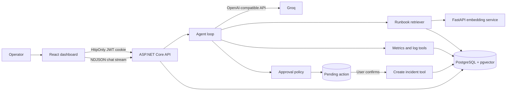

<p align="center">
  
</p>

<h1 align="center">Incident Copilot</h1>

<p align="center">
  An AI-assisted incident investigation platform that grounds answers in service telemetry and internal runbooks, while keeping operational writes behind explicit human approval.
</p>

<p align="center">
  
  
  
  
</p>

Incident Copilot is a full-stack portfolio project for investigating simulated production incidents. It combines retrieval-augmented generation (RAG), multi-step tool calling, streaming chat, durable user conversations, and an approval-gated write workflow in one reproducible local environment.

The project deliberately separates *investigation* from *action*: the model may inspect metrics and logs on its own, but creating an incident requires server-side policy approval followed by an explicit user confirmation.

## Highlights

- **Grounded incident investigation:** retrieves relevant Markdown runbooks from PostgreSQL/pgvector and gives the model read-only tools for current service metrics and logs.
- **Multi-step agent loop:** executes one tool per round, feeds verified results back to the model, and enforces a five-round limit.
- **Human-in-the-loop writes:** converts `create_incident` calls into durable pending actions; only the confirmation endpoint can execute them.
- **Streaming and persistence:** streams newline-delimited JSON (NDJSON) while saving user-scoped conversations, messages, sources, execution metadata, and pending-action state.
- **Operational dashboard:** includes service health, time-series telemetry, searchable logs, incident management, and switchable failure scenarios.
- **Authentication:** uses password hashing and JWTs stored in `HttpOnly`, `SameSite=Strict` cookies; API routes are authenticated by default.
- **Reproducible environment:** starts the frontend, API, embedding service, and pgvector database with Docker Compose.

## Architecture



The backend follows a layered architecture:

| Project | Responsibility |
| --- | --- |
| `IncidentCopilot.Core` | Domain entities, enums, and provider-independent AI contracts |
| `IncidentCopilot.Application` | Agent orchestration, RAG interfaces, approval policies, and application ports |
| `IncidentCopilot.Infrastructure` | EF Core/PostgreSQL persistence, pgvector retrieval, Groq and embedding clients, and tool implementations |
| `IncidentCopilot.Api` | Authentication, HTTP/streaming endpoints, dependency injection, health checks, and development-only simulation routes |

## How an investigation works

1. The API embeds the operator's question and retrieves the nearest runbook chunks.
2. Chunks beyond the configured distance threshold are discarded; source labels are built from database rows, not generated by the model.
3. The model receives the trusted system policy, the untrusted retrieved context, and definitions for the available tools.
4. Read-only tool requests are validated and executed sequentially. Each result is returned to the model for the next reasoning round.
5. Text is streamed to the browser as NDJSON events, followed by machine-readable source and safe debug metadata.
6. If the model requests an incident write, the server checks its approval policy and creates a pending action instead of executing the write.
7. A user may confirm or cancel that action. Confirmation is transactionally claimed before execution to prevent duplicate writes.

## Safety boundary

Runbooks, user input, logs, tool arguments, and tool output are treated as untrusted data. The model cannot directly invoke the incident write path.

| Control | Purpose |
| --- | --- |
| Tool allow-list and typed argument validation | Restricts the actions and inputs available to the model |
| Read/write separation | Allows telemetry inspection without granting automatic mutation |
| Server-side approval policy | Requires evidence before an incident proposal is accepted |
| Durable pending action | Makes the proposed action and its state explicit and reviewable |
| User-bound confirmation endpoint | Prevents one user from confirming another user's action |
| Database row lock and state transition | Prevents repeated confirmation from executing the write twice |
| Sanitized developer metadata | Exposes sources, durations, and tool names without prompts, credentials, raw results, or hidden reasoning |

These controls demonstrate a safer agent design; they do not make this demo a production security boundary. See [Known limitations](#known-limitations).

## Tech stack

| Layer | Technologies |
| --- | --- |
| Frontend | React 19, TypeScript, Vite, TanStack Query, TanStack Table, Zustand, Recharts, Tailwind CSS |
| Backend | ASP.NET Core 9, C#, Entity Framework Core, JWT bearer authentication |
| AI and retrieval | Groq's OpenAI-compatible API, FastAPI, Sentence Transformers, `all-MiniLM-L6-v2`, pgvector |
| Data | PostgreSQL 17 |
| Delivery and quality | Docker Compose, xUnit, Oxlint |

## Quick start

### Prerequisites

- Docker Desktop with Docker Compose
- A [Groq API key](https://console.groq.com/keys)

### 1. Configure and start the stack

```powershell
Copy-Item .env.example .env
# Replace GROQ_API_KEY in .env, then run:
docker compose up --build
```

The embedding image downloads and bakes in `sentence-transformers/all-MiniLM-L6-v2`, so the first build takes longer. In Development, the API applies EF Core migrations and seeds demo services and incidents on startup.

### 2. Create an account and index the runbooks

Open <http://localhost:5173> and register. Because the authentication cookie is scoped to `localhost`, you can then open Swagger at <http://localhost:5087/swagger> and call `POST /api/knowledge/reindex`.

Alternatively, create a disposable local account and retain its authenticated session from PowerShell:

```powershell
$registration = @{
  displayName = 'Demo User'
  email = 'demo@example.com'
  password = 'DemoPassword123'
} | ConvertTo-Json

Invoke-RestMethod `
  -Method Post `
  -Uri http://localhost:5087/api/auth/register `
  -ContentType 'application/json' `
  -Body $registration `
  -SessionVariable incidentSession

Invoke-RestMethod `
  -Method Post `
  -Uri http://localhost:5087/api/knowledge/reindex `
  -WebSession $incidentSession
```

### 3. Open the services

| Service | URL | Notes |
| --- | --- | --- |
| Incident Copilot | <http://localhost:5173> | Main application |
| Swagger UI | <http://localhost:5087/swagger> | Available in Development |

Stop the environment with:

```powershell
docker compose down
```

Add `--volumes` only when you intentionally want to delete the local database data.

## Demo walkthrough

1. Choose **Database Connection Exhaustion** from the dashboard scenario switcher and allow telemetry to populate.
2. Ask: `Check OrderService's current metrics and recent logs and tell me why it is unhealthy.`
3. Expand **Developer details** to inspect retrieved sources, tool durations, agent rounds, total latency, and pending-action state.
4. Ask the copilot to create an incident. Review the proposed write and explicitly confirm or cancel it.
5. Open the **Incidents** page to see the created record and update its lifecycle state.
6. Start a second conversation and use the history picker to demonstrate user-scoped persistence.

## Local development

Run PostgreSQL and the embedding service in containers:

```powershell
docker compose up -d postgres embedding-service
$env:GROQ_API_KEY = 'gsk_...'
dotnet run --project backend/IncidentCopilot.Api --launch-profile http
```

In another terminal:

```powershell
Set-Location frontend
npm ci
npm run dev
```

Vite proxies `/api` to `http://localhost:5087`. Local database and JWT development settings are in `appsettings.Development.json`; use user secrets or environment variables for real credentials.

Important configuration:

| Setting | Environment variable | Purpose |
| --- | --- | --- |
| `Groq:ApiKey` | `GROQ_API_KEY` or `Groq__ApiKey` | Required for live model responses |
| `Jwt:SigningKey` | `JWT_SIGNING_KEY` or `Jwt__SigningKey` | Must be at least 32 characters outside local Development |
| `ConnectionStrings:DefaultConnection` | `ConnectionStrings__DefaultConnection` | PostgreSQL connection string |
| `EmbeddingService:BaseUrl` | `EmbeddingService__BaseUrl` | FastAPI embedding service URL |

## Verification

```powershell
dotnet test IncidentCopilot.sln --configuration Release

Push-Location frontend
npm ci
npm run lint
npm run build
Pop-Location

docker compose config
```

## Repository layout

```text
.
|-- backend/
|   |-- IncidentCopilot.Api/
|   |-- IncidentCopilot.Application/
|   |-- IncidentCopilot.Core/
|   |-- IncidentCopilot.Infrastructure/
|   `-- IncidentCopilot.IntegrationTests/
|-- frontend/                 # React dashboard and chat UI
|-- embedding-service/        # FastAPI sentence-transformer service
|-- docs/
|   `-- runbooks/             # Knowledge base indexed into pgvector
`-- docker-compose.yml
```

## Known limitations

- Service telemetry and incidents are local simulations, not integrations with external monitoring or ticketing systems.
- Conversation history is persisted but previous turns are not yet added to the model context; each prompt starts an independent agent run.
- Authentication is appropriate for a local portfolio demo, but there is no refresh-token flow, login rate limiting, account recovery, role model, or production secret-management setup.
- Incidents are shared operational records; the demo does not implement organization or tenant isolation.
- The approval workflow covers one write tool and is not a general authorization framework.
- Migrations run automatically in Development. A real deployment should apply reviewed migrations separately and use managed secrets.

## Documentation

- [Incident-response runbook](docs/runbooks/incident-response.md)
- [Database connection exhaustion runbook](docs/runbooks/database-connection-exhaustion.md)

---

This repository is a portfolio demonstration of full-stack engineering, agent orchestration, retrieval-augmented generation, and approval-gated tool execution. It is not intended to manage real incidents without additional security, reliability, and integration work.
